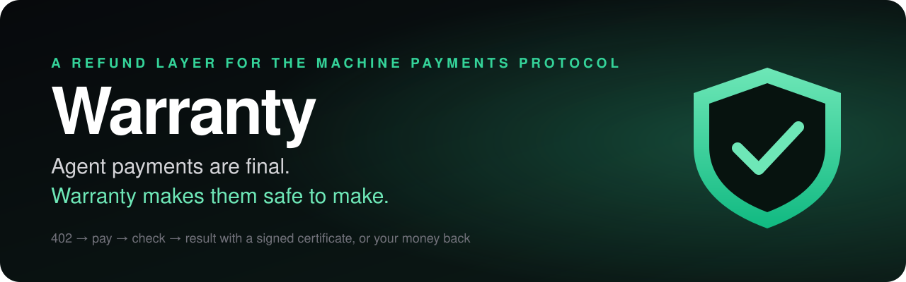
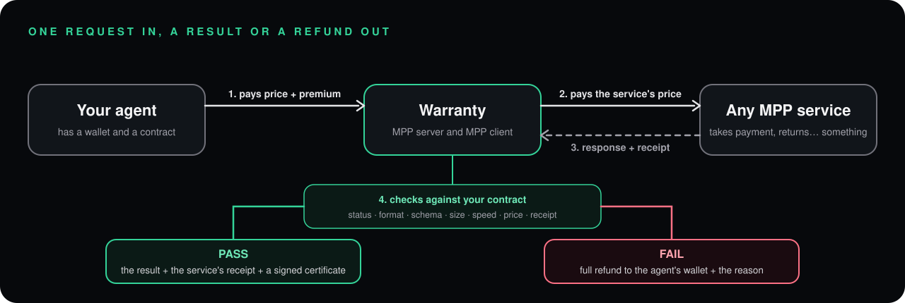
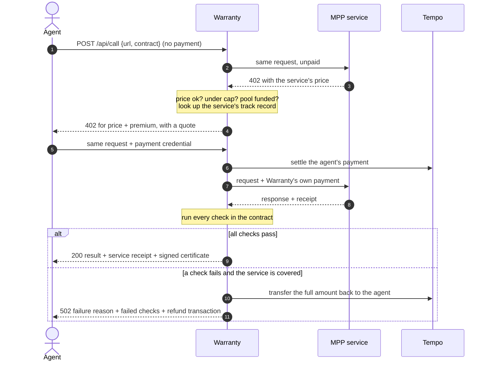
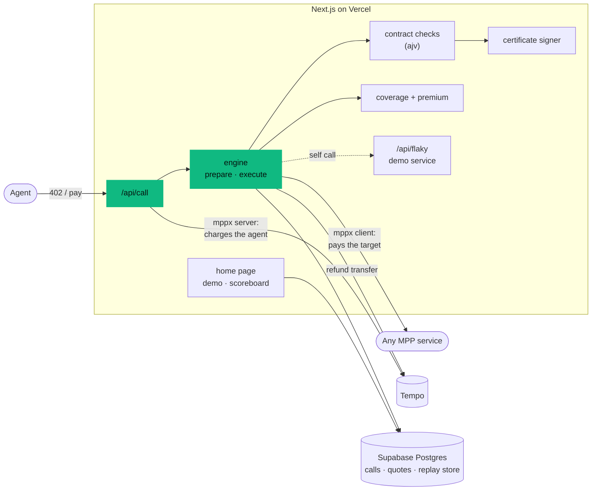

<p align="center">
  
</p>

<p align="center">
  <a href="https://warranty-mpp.vercel.app"></a>
  
  
  
</p>

<p align="center">
  <b>A money-back guarantee for the Machine Payments Protocol.</b><br>
  Your agent pays once. It gets the result with a signed certificate, or its money back.
</p>

> **Warranty: a money-back guarantee for MPP payments.** Machine payments settle instantly and can't be undone, so an agent that pays a service and gets an error, a timeout or the wrong format has no recourse. Call the service through Warranty instead. You pay the service's price plus a small premium. Warranty pays the service, checks the result against your contract, and automatically refunds you if the result breaks it. Every call also feeds a public reliability score for MPP services.
>
> <sub>Refunds apply to covered services, meaning ones with a track record. New services are checked and certified but not refunded; see <a href="#why-the-pool-cannot-simply-be-drained">why</a>.</sub>

---

## Contents

- [The problem](#the-problem)
- [What Warranty does](#what-warranty-does)
- [Try it in 30 seconds](#try-it-in-30-seconds)
- [How a covered call works](#how-a-covered-call-works)
- [The contract](#the-contract)
- [What comes back](#what-comes-back)
- [Pricing: the premium is a reliability signal](#pricing-the-premium-is-a-reliability-signal)
- [Why the pool cannot simply be drained](#why-the-pool-cannot-simply-be-drained)
- [Certificates](#certificates)
- [API reference](#api-reference)
- [Architecture](#architecture)
- [Run it yourself](#run-it-yourself)
- [Verification](#verification)
- [Honest limits](#honest-limits)
- [Roadmap](#roadmap)

## The problem

The [Machine Payments Protocol](https://mpp.dev) lets an agent pay for an API result inside the same HTTP request. No checkout page, no account, no API key. On the stablecoin rail that payment settles in seconds and **cannot be undone**.

That is the feature. It is also the gap:

- The service takes the money and returns a `500`.
- It returns `200` with an HTML error page where JSON was promised.
- It answers after your agent's deadline has passed.
- It never sends a receipt.

In every case the agent has paid and has nothing to show for it. There is no chargeback, no dispute flow, and no way to know beforehand which services are dependable. A human would notice and complain. An agent making a thousand purchases a day cannot.

Tools exist for checking a service before paying and for capping what an agent spends. Nothing on MPP covers what happens **after** the payment.

## What Warranty does

Warranty is an MPP proxy that is a paid server and a paying client at the same time.

<p align="center">
  
</p>

| | |
|---|---|
| 🛡️ **Refunds, automatically** | If a covered service fails any check, the full amount (price and premium) goes back to the wallet that paid, in the same request, with the transaction hash. No human is involved. |
| 📜 **A contract your agent writes** | Expected status, content type, JSON Schema, minimum size, maximum latency, maximum price. Warranty checks the response against it. |
| 🔏 **Signed certificates** | Every call, pass or fail, produces a certificate signed by the Warranty wallet. Anyone can verify it. |
| 📈 **Risk-based price** | The premium follows each service's observed failure rate, so the 402 your agent receives already tells it how reliable the target is. |
| 🏆 **A public scoreboard** | Pass rate, call count, median latency and most common failure for every service called through Warranty. No hidden formula. |
| 🔑 **Nothing to sign up for** | It is itself an MPP service. The payment is the authentication. |

## Try it in 30 seconds

**In the browser:** open [warranty-mpp.vercel.app](https://warranty-mpp.vercel.app) and press either demo button. A real agent with a funded test wallet buys from *Flaky Weather*, a paid service built to break on request. You watch the 402, the payment, the checks, and either the certificate or the refund.

**From a terminal or a coding agent:**

```bash
# one-time: a testnet wallet with free test funds
npx mppx account create --network testnet
npx mppx account fund   --network testnet

# buy from a service that returns garbage, through Warranty
npx mppx https://warranty-mpp.vercel.app/api/call --network testnet -J '{
  "url": "https://warranty-mpp.vercel.app/api/flaky?mode=garbage",
  "contract": { "status": 200, "content_type": "application/json" }
}'
```

You pay about a cent and a half, the check fails, and the refund lands in your wallet. Change `mode=garbage` to `mode=ok` to see a pass.

Agents can read the whole guide at [`/llms.txt`](https://warranty-mpp.vercel.app/llms.txt).

## How a covered call works



Three rules keep this fair to the caller:

1. **Nothing is charged until Warranty knows it can try.** If the target is unreachable, does not ask for payment, quotes above your `max_price`, or exceeds the coverage cap, the request is rejected before any money moves.
2. **A broken request is never charged.** A missing or malformed body gets a `402` that explains the problem. Any payment credential attached to it is discarded, not settled.
3. **The quote holds for 60 seconds.** The price in the `402` and the price charged on the paid retry are the same.

## The contract

Sent by the agent in the body of `POST /api/call`:

```jsonc
{
  "url": "https://service.example/api/thing?x=1",  // the MPP endpoint to buy from
  "method": "GET",                                  // or "POST", with "body" and "headers"
  "contract": {
    "status": 200,                      // expected HTTP status (default 200)
    "content_type": "application/json", // optional, prefix match
    "json_schema": { "type": "object", "required": ["city", "temp_c"] }, // optional
    "min_bytes": 1000,                  // optional
    "max_latency_ms": 10000,            // default 10000, max 25000
    "max_price": "0.05"                 // optional: refuse if the service quotes more
  }
}
```

Two checks always run, whatever the contract says: **a valid payment receipt came back**, and **the amount charged was no more than the amount quoted**.

| Failure reason | Meaning |
|---|---|
| `timeout` | No response, or a response slower than `max_latency_ms` |
| `http_error` | Status differs from the contract |
| `wrong_content_type` | Content type does not match |
| `schema_mismatch` | Body is not JSON, or does not satisfy the JSON Schema |
| `too_small` | Body is shorter than `min_bytes` |
| `no_receipt` | The service took payment but sent no valid receipt |
| `overcharge` | More was charged than quoted |
| `payment_failed` | The service did not accept Warranty's payment |

## What comes back

**Pass** (`200`, with a `Payment-Receipt` header). Real output from the live service:

```jsonc
{
  "verdict": "pass",
  "covered": true,
  "price": { "target": "0.01", "premium": "0.00625", "total": "0.01625" },
  "latency_ms": 1093,
  "checks": [
    { "name": "latency", "ok": true }, { "name": "receipt", "ok": true },
    { "name": "status", "ok": true },  { "name": "content_type", "ok": true },
    { "name": "json_schema", "ok": true }, { "name": "price", "ok": true }
  ],
  "result": {
    "status": 200,
    "content_type": "application/json",
    "encoding": "utf8",                 // "base64" for binary results such as images
    "body": "{\"city\":\"Dublin\",\"temp_c\":11,\"conditions\":\"light rain\",\"wind_kph\":24}"
  },
  "target_receipt": { "method": "tempo", "status": "success", "reference": "0x2639…f909" },
  "certificate": { "body": { /* … */ }, "signer": "0x0b68…74bA", "signature": "0x3a00…" },
  "certificate_url": "https://warranty-mpp.vercel.app/api/certificate/<id>"
}
```

**Fail** (`502`, so a naive caller never mistakes it for data):

```jsonc
{
  "verdict": "fail",
  "covered": true,
  "failure_reason": "wrong_content_type",
  "checks": [
    { "name": "content_type", "ok": false, "expected": "application/json", "actual": "text/html; charset=utf-8" }
  ],
  "refund": {
    "amount": "0.015",
    "status": "sent",
    "tx": "0x440080ffc919e52c326a683acceb919d19f64b033ea53c2227da697637327fba"
  },
  "result": null,
  "certificate": { /* signed record of the failure and the refund */ }
}
```

## Pricing: the premium is a reliability signal

```
total = the service's own price + premium
```

For a **covered** service the premium is the largest of:

- a floor of `0.005`
- 10% of the service's price
- the service's observed failure rate × 1.25 × its price

The failure rate comes from the last 7 days of calls through Warranty, smoothed so a short record never reads as 0% or 100%. A flat premium would lose money on any service that fails more than about one call in eleven. Pricing by risk fixes that, and it has a useful side effect: **an agent can read how dependable a service is from the 402 alone**, before spending anything. During testing the premium on the demo service moved between `0.005` and `0.0175` as its failures accumulated.

`GET /api/quote?url=…` returns the same numbers for free.

## Why the pool cannot simply be drained

A refund guarantee invites an obvious attack: run a paid service that returns junk, call it through Warranty, and collect a refund on every call while your own service keeps the payment. Warranty has three defences, and the first is the important one.

| Defence | How it works |
|---|---|
| **Coverage is earned** | A service is covered only once it has at least 5 recorded calls with a pass rate of 50% or better (or is on a hand-kept trusted list). Until then Warranty still pays it, checks the result and issues a certificate, but for a flat inspection fee and **with no refund**. The quote says `"covered": false` before the agent pays. |
| **Refund limit per payer** | One wallet can receive at most 25 refunds in 24 hours. Beyond that its calls are checked, not refunded. |
| **Caps** | Coverage is capped at `1.00` per call, and Warranty refuses a call its pool cannot fund. |

This narrows the attack; it does not remove it. A patient attacker can build a good record and then turn bad. The proper answer is **service bonds**: the service stakes its own funds and its failures are paid from that stake. That is on the [roadmap](#roadmap).

## Certificates

Every call produces a certificate: target, payer, prices, verdict, each check with expected and actual values, the service's receipt, a SHA-256 of the result, and the refund transaction if there was one.

It is signed with the Warranty wallet using EIP-191 (`personal_sign`) over the certificate body serialised as JSON with keys sorted at every level. To verify one yourself:

```ts
import { verifyMessage } from "viem";

const { certificate } = await fetch("https://warranty-mpp.vercel.app/api/certificate/<id>").then((r) => r.json());
const canonical = (v: unknown): string =>
  Array.isArray(v) ? `[${v.map(canonical).join(",")}]`
  : v && typeof v === "object"
    ? `{${Object.keys(v).sort().filter((k) => (v as any)[k] !== undefined).map((k) => `${JSON.stringify(k)}:${canonical((v as any)[k])}`).join(",")}}`
    : JSON.stringify(v);

await verifyMessage({ address: certificate.signer, message: canonical(certificate.body), signature: certificate.signature }); // true
```

`GET /api/certificate/<id>` also reports `signature_valid`.

## API reference

| Route | Paid | Purpose |
|---|---|---|
| `POST /api/call` | ✅ price + premium | A covered call. `402` → pay → result with certificate, or refund |
| `GET /api/flaky?mode=ok\|garbage\|slow\|error\|random` | ✅ `0.01` | Demo service that misbehaves on request. Paid to a separate wallet, so money really moves between parties |
| `GET /api/quote?url=…` | free | What a covered `GET` to that target costs right now |
| `GET /api/certificate/{id}` | free | A certificate and whether its signature is valid |
| `GET /api/scores` | free | Reliability of every service called through Warranty |
| `GET /api/scores/{host}` | free | One service's last 50 calls |
| `GET /api/stats` | free | Totals, failure reasons, latest calls, split by source |
| `POST /api/demo/run?scenario=pass\|fail` | free, rate limited | Runs the demo agent. Powers the buttons on the home page |
| `GET /openapi.json` | free | Discovery document with `x-payment-info` |
| `GET /llms.txt` | free | Plain-English guide for agents |

## Architecture



| File | Job |
|---|---|
| `src/app/api/call/route.ts` | The paid route: quote, charge, hand over to the engine, shape the response |
| `src/lib/engine.ts` | `prepare` (read the target's price, decide terms) and `execute` (pay, check, refund, certify, record) |
| `src/lib/contract.ts` | Validates the request and runs the checks |
| `src/lib/coverage.ts` | Who is covered, and the premium |
| `src/lib/mpp.ts` | MPP server: issues 402 challenges, verifies payments, identifies the payer |
| `src/lib/buyer.ts` | MPP client: Warranty as a paying customer, and the demo agent |
| `src/lib/tempo.ts` | Refund transfers and pool balance |
| `src/lib/certificate.ts` | Canonical form, signing, verification |
| `src/lib/ssrf.ts` | Refuses targets that resolve to private networks |
| `src/lib/store.ts` | Schema, call log, quotes, scores, demo rate limit |
| `src/lib/config.ts` | Every product rule (caps, rates, thresholds) in one file |
| `src/lib/env.ts` | The only place environment variables are read |

**Stack:** Next.js 16 · [mppx](https://github.com/wevm/mppx) (server and client) · viem · Tempo · Supabase Postgres · Vercel. Database and hosting were provisioned with [Stripe Projects](https://docs.stripe.com/projects).

## Run it yourself

You need Node 20+, the [Stripe CLI](https://docs.stripe.com/stripe-cli) with the `projects` plugin, and a few minutes.

```bash
git clone https://github.com/neuralnomad26/warranty && cd warranty
npm install

# 1. database and hosting, free tiers
stripe projects init warranty
stripe projects add supabase/free && stripe projects add supabase/project
stripe projects add vercel/hobby  && stripe projects add vercel/project
stripe projects env --pull                      # writes .env

# 2. three testnet wallets
npx mppx account create --network testnet -a warranty-pool
npx mppx account create --network testnet -a warranty-flaky
npx mppx account create --network testnet -a demo-agent
npx mppx account fund   --network testnet -a warranty-pool
npx mppx account fund   --network testnet -a demo-agent
```

Copy `.env.example` to `.env.local` and fill it in: the three addresses, the pool and demo-agent private keys (`npx mppx account export -a <name>`), and `MPP_SECRET_KEY` from `openssl rand -hex 32`. Tables are created on first request.

```bash
npm run dev
curl -i -X POST http://localhost:3000/api/call          # expect 402 + WWW-Authenticate: Payment
npx mppx validate http://localhost:3000
```

To deploy, set the same variables on Vercel plus `MPP_REALM=<your hostname>` and `PUBLIC_ORIGIN=https://<your hostname>`, then `vercel deploy --prod`. The realm must equal the production hostname or the validator will flag it.

> **Secrets.** `.env`, `.env.local` and `.projects/vault/` are gitignored. The pool's private key lives on the server because the server has to send refunds. Use testnet keys only until this has had a security review.

## Verification

What was actually run against the live deployment, on Tempo testnet:

| Check | Result |
|---|---|
| `npx mppx validate https://warranty-mpp.vercel.app` | 54 passed, 0 failed, 0 warnings, 2 skipped (the validator's second payment attempt could not run against testnet) |
| Unpaid `POST /api/call` | `402` with `WWW-Authenticate: Payment` |
| Covered call to a working service | `pass`, six checks green, signed certificate, about 1.1 s for the service leg |
| Covered call to a service returning HTML | `fail` · `wrong_content_type`, refund sent with transaction hash |
| Covered call to a service returning `500` after payment | `fail` · `no_receipt`, refund sent with transaction hash |
| Call from an outside wallet via the `mppx` CLI | Same behaviour as the demo agent |
| `GET /api/certificate/{id}` | `signature_valid: true` |

Not yet tested: concurrent calls at volume, POST targets with large bodies, services that pay out in a token the pool does not hold.

## Honest limits

- **It checks form, not truth.** Status, format, shape, size, speed, price and receipt can be verified automatically. Whether the weather forecast is right cannot.
- **Test money.** The pool, the payments and every refund are on Tempo testnet.
- **"Final" means the stablecoin rail.** Card payments made through MPP's Stripe method can be refunded and disputed in the usual way. The gap Warranty fills is on Tempo.
- **New services are checked, not covered.** See [why](#why-the-pool-cannot-simply-be-drained).
- **Scores are young.** They come from few calls so far, mostly the demo. The page always shows the call count next to the percentage.
- **One wallet, one pool.** The pool key sits on the server and calls from one wallet are not yet sequenced against each other, so heavy concurrent load could cause payments to collide and retry.
- **Tempo charge only.** Targets that accept only other methods or sessions are rejected up front, with no charge.
- **The price check is true by construction.** Warranty signs a payment for exactly the quoted amount, so a service cannot take more.
- **Words matter with real money.** A guarantee funded by pooled premiums can count as insurance, which is regulated. That needs proper advice before mainnet.

## Roadmap

- [x] Covered call: quote → 402 → pay → check → certificate or refund
- [x] Risk-based premium and the "checked, not covered" rule
- [x] Signed, publicly verifiable certificates
- [x] Demo service, demo agent, public page and scoreboard
- [x] `openapi.json` with `x-payment-info`, `llms.txt`, `mppx validate` clean
- [ ] **Scanner:** a daily covered call to each read-only MPP service, so the scoreboard covers the ecosystem
- [ ] **Service bonds:** services stake funds and their failures are paid from their own stake
- [ ] **MCP tool** `warranty_call(url, contract)` for Claude, Cursor and other agents
- [ ] **Stripe card payments** with native Stripe refunds as a second method
- [ ] Mainnet, after a security review of the pool wallet

---

<p align="center">
  Built for the MPP hackathon with <a href="https://mpp.dev">MPP</a>, <a href="https://github.com/wevm/mppx">mppx</a>, Tempo and <a href="https://docs.stripe.com/projects">Stripe Projects</a>.
</p>
